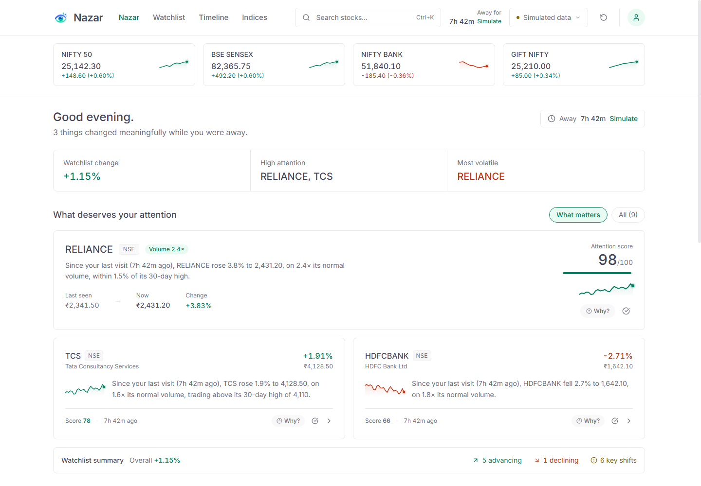
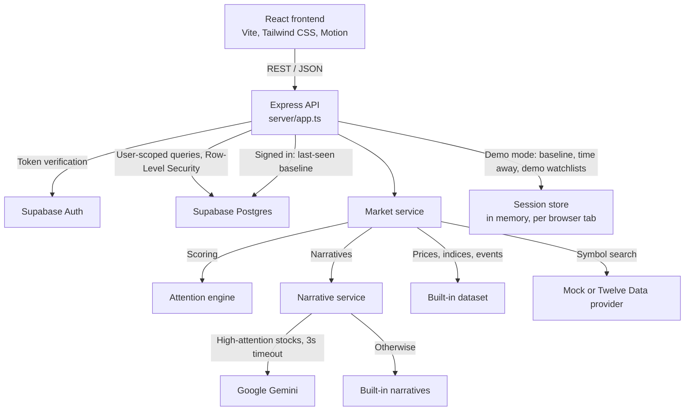
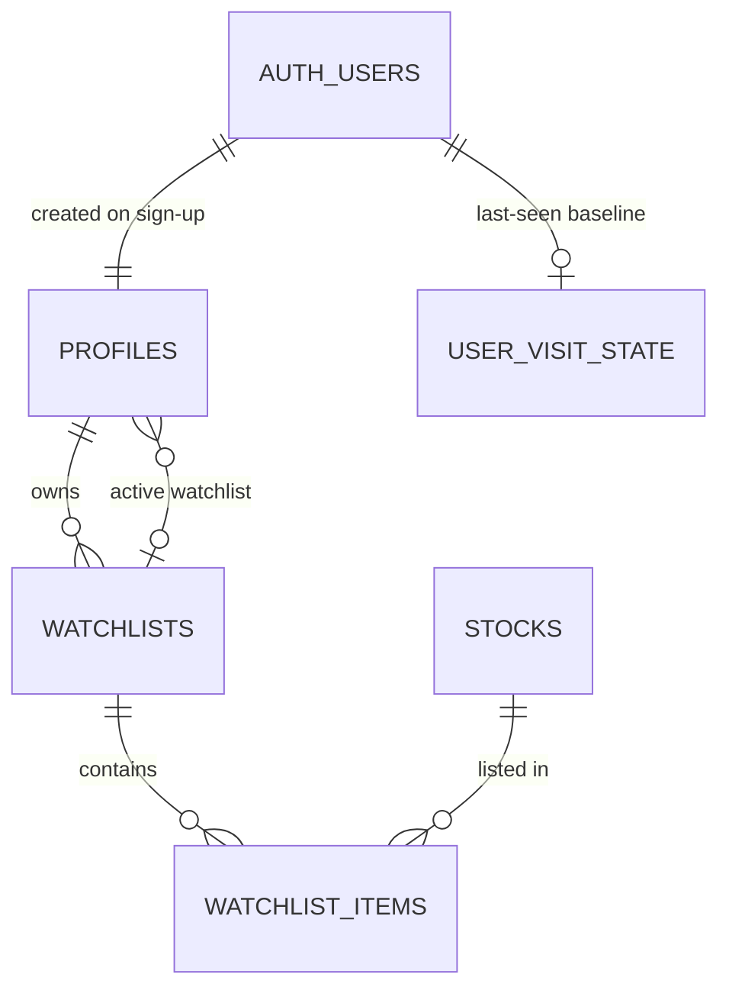

# Nazar

**A market watchlist that tells you what changed while you were away, and whether it matters.**

A conventional watchlist answers one question: *what is the price now?* Nazar answers a more useful one: *what moved since I last looked, why did it move, and does it deserve my attention?* Every stock is scored on volume, volatility, breakouts, reversals and your personal change since your last visit, then ranked and explained in plain language.



> **Note:** prices, indices and timeline events come from a built-in, simulated dataset so the full experience works without any market-data subscription. The app labels this clearly as "Simulated data".

---

## Contents

- [Features](#features)
- [How the attention score works](#how-the-attention-score-works)
- [Getting started](#getting-started)
- [Configuration](#configuration)
- [Available scripts](#available-scripts)
- [Architecture](#architecture)
- [API reference](#api-reference)
- [Database](#database)
- [Project structure](#project-structure)
- [Quality and testing](#quality-and-testing)
- [Known limitations](#known-limitations)

---

## Features

**Briefing.** The home screen summarises what happened while you were away: how long you were gone, how many things changed meaningfully, the overall change across your watchlist, and the stocks that deserve attention most, ranked by score.

**Change since your last visit.** Every stock shows the price when you last checked next to the current price, so you see your personal change rather than only the daily change. For signed-in users this baseline is saved to the account, so it follows you across devices and sessions: leaving the page records your visit, and the next time you return Nazar shows what changed since then. A quick glance at another tab does not count as a visit.

**Attention score (0 to 100).** A transparent, rule-based score for each stock. The "Why?" button on any stock breaks the score down into the individual signals and their points.

**Plain-language narratives.** Each stock comes with a short explanation of the move, for example: *"Since your last visit (7h 42m ago), TCS rose 1.9% to 4,128.50, on 1.6x its normal volume, trading above its 30-day high of 4,110."* Optionally, Google Gemini can rephrase these for the highest-attention stocks.

**Watchlists.** Create multiple watchlists, switch between them, and add or remove stocks. Your selected watchlist is remembered.

**Timeline.** A chronological feed of the events that happened during your absence, filterable by Critical, Breakouts and Surges. Events can be acknowledged or dismissed.

**Stock detail.** Price charts for 1D, 1W, 1M, 1Y and All, volume bars, 30-day and 52-week ranges, volatility, market capitalisation and recent events.

**Search.** Press `Ctrl+K` (or `Cmd+K`) to search by symbol, company name, sector or tag, and add stocks to the current watchlist from the results.

**Time-away simulator.** Pick a duration (15 minutes, 2 hours, 7h 42m, 1 day or 3 days) to see how the briefing, scores and timeline look after different absences, without waiting.

**Accounts or demo mode.** Sign in with email and password (Supabase), or choose "Skip for now" to explore the full app instantly in demo mode.

**Accessible by design.** Text colours meet the WCAG AA contrast standard (4.5:1), with keyboard navigation throughout, focus management in dialogs, touch-friendly controls and support for the operating system's reduced-motion setting.

---

## How the attention score works

Every stock starts at **20** points. Five independent signal groups can add points, and the total is capped at **98**. The logic lives in [`server/services/attentionEngine.ts`](server/services/attentionEngine.ts).

| Signal | Condition | Points |
|--------|-----------|--------|
| Volume surge | Volume at least 2x its 30-day average | `min(35, round(ratio x 14))` |
| Elevated volume | Volume between 1.4x and 2x average | +15 |
| Volatility shock | Move at least 2.5x the stock's typical daily volatility | `min(30, round(multiple x 10))` |
| Price momentum | Absolute price change of at least 1.5% | +15 |
| 30-day high breakout | Price at or above its 30-day high | +28 |
| Near 30-day high | Within 1.5% of its 30-day high | +18 |
| Gap reversal | Opened more than 0.8% above the previous close, now more than 1.5% below it | +26 |
| Change since your visit | Price moved at least 2.5% since you last checked | +16 |

Only one rule per group can apply (for example, a volume surge and elevated volume never both count).

**Score levels**

| Score | Level | Meaning |
|-------|-------|---------|
| 75 and above | High | Top priority; eligible for an AI-written narrative |
| 50 to 74 | Medium | Worth a look |
| Below 50 | Low | Normal activity |

In the briefing, a score of 65 or more counts as a "meaningful change", 70 or more is listed under "High attention", and the **What matters** filter shows stocks scoring 55 or more.

**Why these signals.** Volume confirms conviction: a 3% move on 2.4x normal volume means far more than the same move on light volume. Normalising by each stock's own volatility stops naturally volatile stocks from dominating the ranking. A break above the 30-day high marks a level the market has repeatedly tested. A gap-up that reverses below the previous close is a strong risk signal. The personal change makes sure a move during *your* absence gets credit even if the daily number looks modest.

The score is fully deterministic: the same inputs always produce the same score. There is no machine learning involved.

---

## Getting started

### Prerequisites

- Node.js 22.13 or later (24 recommended)
- A Supabase project, for accounts and saved watchlists (optional: without it the app runs in demo mode)
- A Google Gemini API key (optional: built-in narratives are used without it)

### 1. Install

```bash
git clone https://github.com/Mona-Agrawall/nazar.git
cd nazar
npm install
cp .env.example .env
```

### 2. Configure

Fill in `.env` as described in [Configuration](#configuration). To try the app without an account, leave the Supabase values empty, or set `VITE_DEMO_MODE=true`.

### 3. Set up the database (Supabase only)

In the Supabase **SQL Editor**, run these files in order:

1. `supabase/migrations/20260905000001_create_profiles.sql`
2. `supabase/migrations/20260905000002_create_watchlists.sql`
3. `supabase/migrations/20261027000001_one_default_watchlist_per_user.sql`
4. `supabase/migrations/20261027000002_server_controlled_default_watchlist.sql`
5. `supabase/migrations/20261027000003_active_watchlist_ownership.sql`
6. `supabase/migrations/20261027000004_user_visit_state.sql`

All migrations are idempotent, so running them again is safe.

### 4. Run

```bash
npm run dev
```

Open [http://localhost:3000](http://localhost:3000). Use **Skip for now** on the sign-in screen to enter demo mode, and **Simulate** in the header to try different absence durations.

### Production build

```bash
npm run build
npm start
```

The frontend is built into `dist/` and the server into `dist-server/server.cjs`. The project also includes a `vercel.json` for deployment to Vercel, where `api/index.ts` runs the API as a serverless function.

---

## Configuration

All settings are environment variables, read from `.env`.

| Variable | Required | Description |
|----------|----------|-------------|
| `VITE_SUPABASE_URL` | For accounts | Supabase project URL (*Project Settings > API*) |
| `VITE_SUPABASE_PUBLISHABLE_KEY` | For accounts | Supabase publishable (anon) key |
| `SUPABASE_SECRET_KEY` | For accounts | Supabase secret (service role) key; server only, used to seed the stock list |
| `VITE_DEMO_MODE` | No | `true` opens the app without sign-in and lets the server accept requests without a token (needed for "Skip for now") |
| `GEMINI_API_KEY` | No | Enables AI-written narratives for high-attention stocks |
| `GEMINI_ENABLED` | No | Set to `false` to keep the key but pause Gemini calls |
| `GEMINI_MODEL` | No | Gemini model to use (default `gemini-3.6-flash`) |
| `MARKET_DATA_PROVIDER` | No | `mock` (default) or `twelve_data` to use the Twelve Data API for symbol search |
| `PORT` | No | HTTP port (default `3000`) |

If no Supabase values are set, the app automatically runs in demo mode on both the server and the client.

---

## Available scripts

| Command | Description |
|---------|-------------|
| `npm run dev` | Development server on port 3000 (restart it after changing server code) |
| `npm run build` | Production build of the frontend and server |
| `npm start` | Runs the production build |
| `npm run typecheck` | TypeScript check in strict mode |
| `npm run lint` | ESLint, including React hooks rules |
| `npm test` | Regression test suite |
| `npm run format` | Formats the code with Prettier |

---

## Architecture



A single Node.js process serves both the API and the frontend: in development through Vite middleware, in production from the built `dist/` folder. On Vercel the same Express app runs as a serverless function.

| Component | Responsibility |
|-----------|----------------|
| `server/app.ts` | Express app: security headers, all API routes, error handling |
| `server/config.ts` | Supabase settings and demo-mode detection |
| `server/validation.ts` | Validation of request input |
| `server/errors.ts` | Error responses without internal details |
| `server/middleware/auth.ts` | Verifies Supabase tokens; allows tokenless requests in demo mode |
| `server/db/supabaseRepository.ts` | All database access through user-scoped clients, including the saved last-seen baseline |
| `server/services/marketService.ts` | Builds enriched stocks, the briefing summary, timeline events and stock detail |
| `server/services/attentionEngine.ts` | The attention score |
| `server/services/narrativeService.ts` | Narratives, with caching, Gemini timeout and built-in fallbacks |
| `server/services/sessionStore.ts` | Per-tab session for demo mode (last-seen prices, time away, demo watchlists) and the shared baseline logic |
| `src/services/api.ts` | Frontend API client |
| `src/components/` | React user interface |

### Key design decisions

**Scoring runs on the server.** Every client sees the same score for the same stock, and the score cannot be manipulated from the browser.

**The AI is a writer, not a source of data.** Gemini only receives facts that were already calculated (price, change, volume ratio, detected signals) and is asked to describe them. It never estimates prices or makes predictions, and if it is slow or unavailable the built-in narrative is used instead.

**Watchlist changes are atomic.** Creating a watchlist and replacing its stocks happen inside single PostgreSQL functions, so a failure can never leave a watchlist half-updated.

**Your baseline follows you.** For signed-in users, "when you last looked" and the prices at that moment are stored in the database, so the briefing is the same on every device and survives server restarts. Time away is the real time since your last visit.

**Ready to explore immediately.** A new account, and every new browser tab in demo mode, starts in a prepared "away for 7h 42m" scenario, so the full experience is visible straight away without waiting for markets to move.

---

## API reference

| Method | Endpoint | Purpose | Auth |
|--------|----------|---------|------|
| `GET` | `/api/health` | Service health, search provider and Gemini availability | No |
| `GET` | `/api/market/indices` | Market indices | No |
| `GET` | `/api/market/status` | Data feed status | No |
| `GET` | `/api/market/stocks/all` | All supported stocks | No |
| `GET` | `/api/market/search?q=` | Search by symbol, name, sector or tag | No |
| `GET` | `/api/market/stocks?watchlistId=` | Enriched stocks for a watchlist | Yes |
| `GET` | `/api/market/stocks/:symbol` | Stock detail with chart data | Yes |
| `GET` | `/api/market/pulse?watchlistId=` | Briefing summary | Yes |
| `GET` | `/api/market/events?watchlistId=` | Timeline events | Yes |
| `POST` | `/api/market/events/:id/acknowledge` | Mark an event as seen | No |
| `POST` | `/api/market/events/:id/dismiss` | Remove an event from the timeline | No |
| `GET` | `/api/watchlists` | List watchlists | Yes |
| `POST` | `/api/watchlists` | Create a watchlist | Yes |
| `PUT` | `/api/watchlists/:id` | Rename, replace stocks or set as active | Yes |
| `DELETE` | `/api/watchlists/:id` | Delete a watchlist | Yes |
| `POST` | `/api/explain` | One-sentence explanation of a stock's change | No |
| `POST` | `/api/session/time-travel` | Simulate time away (`preset` or `awaySeconds`); saved to the account when signed in | Yes |
| `POST` | `/api/session/sync` | Mark everything as seen, also sent automatically when a signed-in user leaves | Yes |
| `POST` | `/api/demo/reset` | Restore the demo scenario | No |

Routes marked "Yes" expect a Supabase token in the `Authorization: Bearer <token>` header; an invalid token returns `401`. In demo mode, requests without a token use the in-memory session identified by the `X-Session-Id` header. Invalid input returns `400` with an `error` message, unknown API routes return `404`, and unexpected failures return a generic `500` message.

---

## Database



| Table | Contents |
|-------|----------|
| `profiles` | One row per user: display name and active watchlist |
| `stocks` | The supported stocks (seeded by the server) |
| `watchlists` | Watchlists, each owned by one user; one default watchlist per user |
| `watchlist_items` | Which stocks belong to which watchlist |
| `user_visit_state` | Each user's last visit time and the prices at that moment |

**Security.** Row-Level Security is enabled on every table, so users can only read and change their own data. In addition:

- Users can set a watchlist's name, but only the server can mark a watchlist as the default.
- A user's active watchlist must be one of their own watchlists.
- Each user can only read and write their own last-seen baseline.
- At most one default watchlist can exist per user, even under concurrent requests.

**Database functions**

| Function | Purpose |
|----------|---------|
| `handle_new_user()` | Creates a profile when a user signs up |
| `create_watchlist_with_items(name, symbols, is_default)` | Creates a watchlist and its stocks in one step (`is_default` is ignored) |
| `ensure_default_watchlist()` | Creates the user's default watchlist on first use; safe under concurrent calls |
| `replace_watchlist_items(watchlist_id, name, symbols)` | Replaces a watchlist's stocks in one step |
| `check_active_watchlist_owner()` | Enforces that the active watchlist belongs to the user |

---

## Project structure

```text
├── api/
│   └── index.ts                  Vercel serverless entry point
├── server/
│   ├── index.ts                  Local entry point (API + frontend)
│   ├── app.ts                    Express app and API routes
│   ├── config.ts                 Supabase settings, demo-mode detection
│   ├── validation.ts             Request validation
│   ├── errors.ts                 Error handling
│   ├── middleware/auth.ts        Token verification
│   ├── db/supabaseRepository.ts  Database access
│   ├── services/                 Market data, attention engine, narratives, sessions
│   ├── data/                     Built-in stock list and demo scenario
│   ├── providers/                Symbol search and chart history providers
│   └── utils/                    Shared helpers
├── src/
│   ├── App.tsx                   Application shell, data loading, layout
│   ├── components/               User interface components
│   ├── contexts/AuthContext.tsx  Sign-in state and demo mode
│   ├── lib/                      Supabase client, formatting and UI helpers
│   ├── services/api.ts           API client
│   ├── types.ts                  Types shared with the server
│   └── index.css                 Design tokens and global styles
├── supabase/migrations/          Database schema, security rules and functions
├── tests/                        Regression tests
├── docs/                         Images used in this README
├── public/                       Logo and favicon
├── eslint.config.js              Lint configuration
├── vercel.json                   Deployment routing and security headers
└── .env.example                  Environment variable template
```

---

## Quality and testing

- **TypeScript strict mode** across the frontend and server.
- **ESLint** with TypeScript and React hooks rules.
- **Regression tests** (`npm test`) covering watchlist filtering, startup without Supabase, the saved last-seen baseline, edit ordering, API error handling, authentication errors, watchlist renaming and session limits.
- **Security:** input validation, security headers with a Content Security Policy in production, error responses without internal details, and database-level ownership rules.
- **Resilience:** slow or failing Gemini calls fall back to built-in narratives, background tabs stop polling, and out-of-date responses never overwrite newer data.

---

## Known limitations

- **Simulated market data.** Prices, indices and events come from a built-in dataset and do not change. Setting `MARKET_DATA_PROVIDER=twelve_data` switches only symbol search to a live provider.
- **Generated chart history.** Charts use deterministic generated series; the "All" range shows the same data as "1Y".
- **In-memory demo sessions.** In demo mode, last-seen prices and simulated time away are kept in server memory per browser tab, so they reset when the server restarts and are not shared between serverless instances. (Signed-in users are not affected: their baseline is saved to the database. Timeline acknowledgements are still kept per browser tab.)
- **Fourteen supported stocks.** New stocks are added in `server/data/stockUniverse.ts`.
- **Not yet available:** password reset, live price streaming (the app refreshes every 15 seconds), and screens for renaming or deleting watchlists (the API already supports both).
