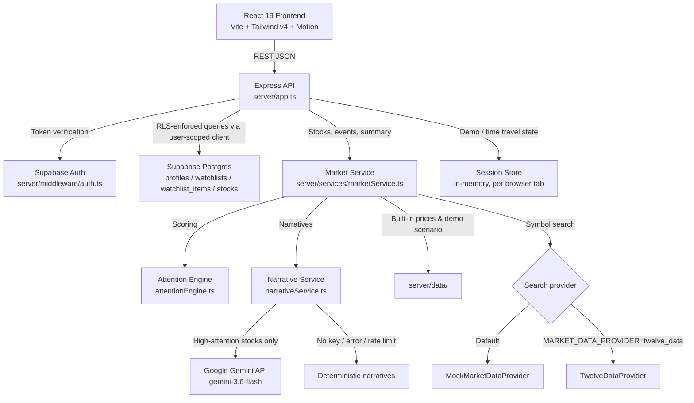
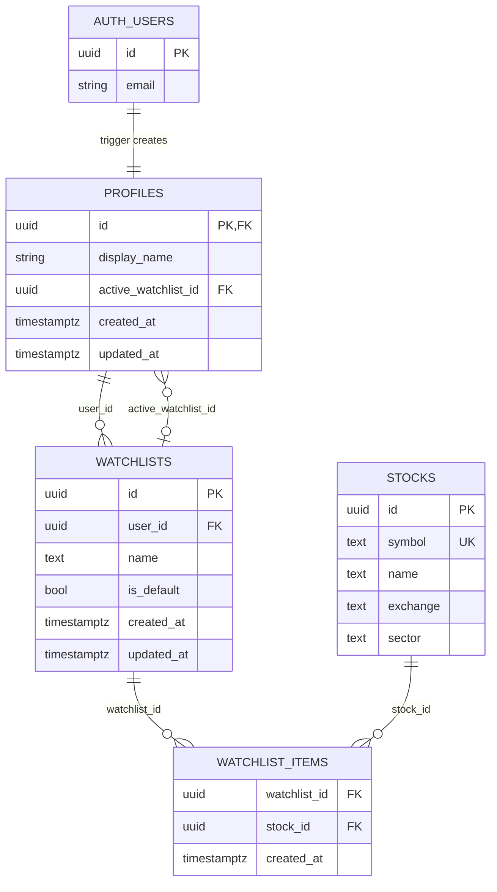

# Nazar - Keep an eye on what matters.

### Code, by Groww 2026 Submission

Nazar is a smart market watchlist built around a single question: **"What changed while I was away, and does it actually matter?"**

A conventional watchlist answers *"what is the current price?"*. Nazar answers *"what moved, why it moved, and whether that movement is worth your attention right now"* — personalised to the exact window of time since your last visit. It does this through a deterministic, multi-factor Attention Scoring Engine that runs server-side on every request, combined with a per-user price snapshot system that stores where prices were when you last checked.

## LIVE DEPLOYED LINK - https://groww-pulse-iota.vercel.app/


---

## 1. Product Overview

### The Problem with Conventional Watchlists

A standard watchlist shows you current prices. It does not tell you:
- Whether a 2% move happened *during* your absence or *before* it
- Whether that 2% is significant relative to this stock's normal volatility
- Whether volume confirmed the move or not
- Whether a gap-up that subsequently reversed is more important than a steady upward grind
- Which of your 12 tracked stocks actually deserves your attention right now

The result: users scan their entire watchlist on every visit, manually comparing prices they half-remember from yesterday. That cognitive overhead compounds across sessions.

### What Nazar Does Differently

When a user returns to Nazar, the system:
1. **Measures the time elapsed** since their last session (or a simulated absence)
2. **Compares current market state against a per-user price snapshot** taken at their last visit — not just against yesterday's close
3. **Runs a proprietary Attention Score** (0–100) for every watched stock, factoring in volume, volatility, technical breakouts, intraday reversals, and the personal delta since the user's last check
4. **Surfaces a ranked, filterable view** of what changed meaningfully, ordered by attention score
5. **Generates a human-readable narrative** (via Google Gemini or a deterministic fallback) explaining *why* a move matters

The output is a prioritised briefing, not a raw price feed.

### Primary User Journey

```
User visits Nazar
  → Signs in (or skips auth for demo mode)
  → Session records current prices as baseline snapshot
  → User browses the watchlist, then leaves

[Time passes — market moves]

User returns
  → Nazar calculates elapsed time since last visit
  → Compares current prices against stored snapshot prices
  → Runs Attention Engine on every watched stock
  → Presents sorted list: highest-attention stocks first
  → Top Nazar card shows "You were away 7h 42m — 3 things changed meaningfully"
  → User opens any stock → sees "Last seen at ₹2,341 → Now ₹2,431 (+3.8%)" + why it matters
  → User can acknowledge, dismiss, or deep-dive events
  → User taps "Sync Now" → current prices become new baseline
```

---

## 2. Core Features

### Watchlist Management
Create and switch between multiple named watchlists, and add or remove stocks from a searchable universe (currently 14 symbols across NSE and NASDAQ). The default watchlist auto-initialises with major NIFTY 50 constituents for authenticated users via a PostgreSQL RPC.

### Nazar Hero
The primary entry screen. Surfaces the top 3 highest-attention stocks from the active watchlist, the total count of meaningful changes, and a plain-English summary narrative ("You were away for 7h 42m..."). This is the "what happened while I was away" answer.

### Attention Score (0–100)
Every stock receives a score computed deterministically on every API call. It combines up to five independent signals. Stocks are sorted by score descending. Users can toggle a filter to see only stocks above the attention threshold.

### Per-User Price Delta
Every stock card shows the exact price when the user last visited and the current price — not yesterday's close. The comparison is user-specific, not market-universal.

### Change Timeline
A chronological event feed showing *what happened and when* within the user's absence window. Each event has a mini price chart, an explanation, and can be acknowledged or dismissed. The timeline is scoped to the active watchlist.

### Stock Detail Modal
Deep-dive on any stock: multi-timeframe SVG price charts (1D/1W/1M/1Y/ALL), volume bars, 30-day high, 52-week range, market cap, daily volatility, recent events, and a "why it matters" explanation.

### AI Explanation Layer (Google Gemini)
For high-attention stocks, Gemini `gemini-3.6-flash` writes a concise 1–2 sentence narrative of the price action. The model receives only pre-computed, deterministic facts — it is used as a natural-language renderer, never as a data source. If Gemini is not configured, unavailable or rate-limited, deterministic narratives are served with no user-visible impact.

### Time Travel Simulator
A developer/demo tool that sets the simulated `lastVisitTimestamp` to a chosen distance in the past (15m, 2h, 7h 42m, 24h, 3 days). It also adjusts the per-user price snapshot to match that moment, so the entire Attention Engine reacts as if the user genuinely was away for that period. This allows the full "you were away" flow to be demonstrated without waiting.

### Authentication + Demo Mode
Full Supabase Auth (email/password) with server-side JWT verification. All watchlist endpoints enforce Row-Level Security so users can only access their own data. A "Skip for now" button activates demo mode, which uses an in-memory, per-browser-tab session on the server (requires `VITE_DEMO_MODE=true` on the server) — useful for reviewers.

---

## 3. What Counts as a "Meaningful Change"?

This is the core engineering problem Nazar addresses. The answer is implemented in `calculateAttention()` in [`server/services/attentionEngine.ts`](./server/services/attentionEngine.ts).

### Scoring Model

Every stock starts at a baseline score of **20**. Five independent factors can add points. The score is capped at **98** for realism (a score of 100 would imply perfect information).

| Factor | Condition | Points Added |
|--------|-----------|-------------|
| **Volume Surge** | Volume ≥ 2.0× 30-day average | `min(35, round(ratio × 14))` |
| **Elevated Volume** | Volume between 1.4×–1.99× average | +15 |
| **Volatility Shock** | Price move ≥ 2.5× the stock's historical daily volatility | `min(30, round(multiple × 10))` |
| **Price Momentum** | Absolute price change ≥ 1.5% | +15 |
| **30-day High Breakout** | Current price ≥ 30-day high | +28 |
| **Near-High** | Within 1.5% of 30-day high | +18 |
| **Intraday Gap Reversal** | Opened >0.8% above close, then fell >1.5% below close | +26 |
| **User Delta** | Price moved ≥ 2.5% since user's last visit (personal) | +16 |

**Score → Level mapping:**
- ≥ 75: `high` (shows in Nazar hero, top priority)
- 50–74: `medium`
- < 50: `low`

### Why These Signals?

**Volume is a conviction proxy.** A 3% price move on 2.4× normal volume means institutional participants were actively involved. The same 3% move on 0.8× volume is speculative noise. Volume weighting is the single most important differentiator from a naive percentage-change sort.

**Volatility normalisation prevents misleading rankings.** A 2% move in HDFCBANK (typical daily range: 1.45%) is a 1.38× volatility event. A 2% move in BHARTIARTL (typical daily range: 1.10%) is a 1.82× volatility event. Raw percentage ranking would treat these equally; the scoring engine doesn't.

**The 30-day high breakout is a level that the market has repeatedly tested and failed to sustain.** When price clears it with volume, that's technically significant. This is a standard institutional trigger level.

**The intraday gap reversal is specifically a bearish signal.** A stock that opens higher (gap-up) but closes below the previous day's close on high volume signals strong distribution — institutional selling into retail optimism. This is one of the highest-information patterns for risk management. It warrants +26 points because the signal is specific, time-bounded, and not captured by simple daily percentage change.

**The user-personal delta** ensures that a stock which moved sideways for two days and then surged during *your specific* absence gets credit for that surge relative to your snapshot — even if the 24-hour change number looks modest.

### What is Not Counted as Meaningful

- Normal range fluctuation below thresholds
- News events without price/volume confirmation (no news API is integrated)
- Options data, FII/DII flows, or order book depth (not in the current data model)

---

## 4. User Experience

### Auth Flow
Landing screen presents email/password sign-in and sign-up. A "Skip for now" link at the bottom of the card activates demo mode — the user enters the full application immediately using server-side in-memory session data.

### Navigation
Four tabs in the header: **Nazar** (briefing + watchlist), **Watchlist** (watchlist standalone), **Timeline** (chronological event feed), **Indices** (NIFTY 50, SENSEX, BANK NIFTY, GIFT NIFTY cards).

### Watchlist View
Stocks are listed as rows with: symbol, exchange, top scoring factor, the personal delta since your last visit, current price, 24h change, and the colour-coded attention score. Rows can be filtered and sorted by attention, % move, volume or symbol; by default high-attention stocks float to the top.

### Stock Card → Why Modal
Each stock card has a "Why?" button that opens the `AttentionWhyModal`. This explains the score factors with individual point contributions and a plain-English summary of why the stock matters.

### Command Search
`Cmd/Ctrl+K` opens a keyboard-driven command palette for searching stocks, adding/removing from the current watchlist, and navigating.

---

## 5. System Architecture



### Component Responsibilities

| Component | Responsibility |
|-----------|---------------|
| `server/app.ts` | Express app and every API route |
| `server/index.ts` | Local entry point: starts the HTTP server with Vite (dev) or the built frontend (prod) |
| `api/index.ts` | Vercel serverless entry point; re-exports the Express app |
| `server/services/marketService.ts` | Builds enriched stocks, timeline events, the "while you were away" summary and stock detail |
| `server/services/attentionEngine.ts` | The deterministic Attention Score |
| `server/services/narrativeService.ts` | Gemini narratives with deterministic fallbacks and caching |
| `server/services/sessionStore.ts` | Per-tab in-memory session: last-seen prices, away duration, time travel, sync, demo reset |
| `server/db/supabaseRepository.ts` | All Supabase database operations; user-scoped clients enforce RLS |
| `server/middleware/auth.ts` | JWT Bearer verification with Supabase Auth; demo-mode bypass |
| `server/data/` | Stock universe and the canonical demo scenario (indices, events, watchlists) |
| `server/providers/` | Symbol search providers and generated chart history |
| `src/services/api.ts` | Frontend API client; attaches the Supabase token and the per-tab session ID |
| `src/contexts/AuthContext.tsx` | Supabase auth state; exposes `user`, `isDemoMode`, `setDemoMode()` |
| `src/components/` | React UI components; receive data and callbacks as props |

---

## 6. Technology Stack

| Layer | Technology | Reason |
|-------|-----------|--------|
| Frontend framework | React 19 | Concurrent features, stable ecosystem |
| Build tool | Vite 6 | Sub-second HMR, ESM-native, unified dev server |
| Backend framework | Express 4 | Minimal, well-understood, no magic |
| Language | TypeScript 5.8 | Full-stack type safety; shared `types.ts` between frontend and backend |
| Styling | Tailwind CSS v4 | Utility-first; CSS variable design tokens for theming |
| Animations | Motion (`motion/react`) | Declarative `AnimatePresence` for modal transitions and stagger effects |
| Database | Supabase (Postgres) | Managed Postgres with built-in Auth and Row-Level Security; eliminates a separate auth service |
| Authentication | Supabase Auth | Email/password with JWT; JWTs verified server-side on every request |
| AI / LLM | Google Gemini (gemini-3.6-flash) | Narrative text only; structured fact injection prevents hallucination |
| Symbol search (optional) | Twelve Data REST API | Free symbol-search endpoint |
| Market data | Built-in deterministic dataset | Zero API dependency for demos; realistic, reproducible data |
| Icons | Lucide React | Consistent, lightweight |
| Dev runner | tsx | Runs the TypeScript server directly in dev without a build step |
| Production build | Vite + esbuild | Vite bundles the SPA; esbuild bundles the server into `dist-server/server.cjs` (kept out of the public `dist/` folder) |
| Formatting | Prettier | One consistent code style (`npm run format`) |

---

## 7. Data Flow

### A. User Loads a Watchlist

```
Frontend: loadMarketData()
  → GET /api/watchlists (with Bearer token)
     → requireAuth (server/middleware/auth.ts) validates the JWT with Supabase Auth
     → supabaseRepository.getWatchlists(token)
        → Creates user-scoped Supabase client (RLS enforced)
        → Calls ensure_default_watchlist() RPC (idempotent)
        → Fetches watchlists + nested watchlist_items + stocks via Supabase join query
        → Fetches active_watchlist_id from profiles table
        → Returns formatted watchlists array + activeId
  → GET /api/market/stocks?watchlistId=X
     → marketService.getStocks(session, symbols)
        → For each symbol: computes attention score, user delta, sparkline, narrative
     → Returns enriched Stock[] array
  → GET /api/market/pulse?watchlistId=X
  → GET /api/market/events?watchlistId=X
  → GET /api/market/indices

Frontend: updates all state, re-renders, polls again in 15 seconds
```

### B. User Adds a Stock

```
Frontend: handleAddStock(symbol)
  → PUT /api/watchlists/:id { symbols: [...existing, newSymbol] }
     → supabaseRepository.updateWatchlist(token, id, undefined, newSymbols)
        → Calls replace_watchlist_items() RPC atomically
           → Deletes all existing watchlist_items for this watchlist
           → Re-inserts all items (including new symbol) by resolving symbol → stock UUID
           → All inside a single PL/pgSQL function for atomicity
  → Frontend re-calls loadMarketData(activeWatchlistId)
```

Note: add/remove is implemented as a full symbol-set replace via an atomic RPC. This eliminates partial-write races.

### C. User Returns After Absence

The "return" flow is implicit — the attention engine does the work on every `/api/market/stocks` call.

```
session.lastVisitTimestamp   ← set when the user last synced (or on session init)
session.stockSnapshots       ← { symbol: { price, timestamp } } for each stock

GET /api/market/stocks
  → For each stock:
     previousPrice = stockSnapshots[symbol].price
     currentPrice  = BASE_STOCKS[symbol].basePrice
     priceDiff     = currentPrice - previousPrice
     percentDiff   = (priceDiff / previousPrice) × 100
     awayStr       = formatDuration(simulatedAwaySeconds)
  → calculateAttention() runs with previousPrice
  → Stock returned with attentionScore + userDelta { previousPrice, currentPrice, percentDiff, narrative }

Frontend sorts stocks by attentionScore descending
MarketPulseHero shows top 3 high-attention stocks + "You were away for X"
```

### D. External Services Fail

- **Gemini** errors, timeouts and `429` rate limits are caught in `buildStockNarrative()`, which then returns a deterministic narrative. Fallbacks are cached for only 30 seconds so Gemini is retried soon after it recovers.
- **Twelve Data search** failures (HTTP or network errors) return an empty result list.
- **Supabase seeding** on startup is fire-and-forget: a failure is logged and the server keeps running.

If the backend itself fails, the frontend catches the `loadMarketData` error and logs it — the UI keeps the last state it successfully loaded (no hard crash, no blank screen).

---

## 8. Persistence & State Management

### Authenticated Users (Supabase)

| What | Where | How |
|------|-------|-----|
| Watchlist structure (name, symbols) | Supabase `watchlists` + `watchlist_items` tables | Persists across sessions and devices |
| Active watchlist selection | Supabase `profiles.active_watchlist_id` | Updated on every watchlist switch |
| Stock master data | Supabase `stocks` table | Seeded on server startup via the admin client |
| User identity | Supabase Auth (email/password, JWT) | Standard token refresh flow |

### Demo Mode (In-Memory, per Browser Tab)

Each tab sends an `X-Session-Id` header; the server keeps one `UserSession` per ID in `server/services/sessionStore.ts`.

| What | Field | Notes |
|------|-------|-------|
| Watchlists | `watchlists` | Lost on server restart |
| Active watchlist | `activeWatchlistId` | Same |
| Per-user price snapshot | `stockSnapshots` | `{ price, timestamp }` per symbol |
| Last visit timestamp | `lastVisitTimestamp` | Unix ms; controls the away-duration calculation |
| Dismissed/acknowledged events | `dismissedEventIds` / `acknowledgedEventIds` | Cleared by demo reset |

### Client-Side

| What | Where |
|------|-------|
| Intro seen flag | `localStorage.nazar_intro_seen` |
| Per-tab session ID | `sessionStorage.nazar_session_id` |
| Demo scenario initialised flag | `sessionStorage.nazar_demo_initialized` |
| Auth session token | Managed by the Supabase client library |

**The price snapshot baseline** is managed server-side, not in the browser, so it survives page refreshes. "Mark Session as Read" calls `/api/session/sync`, which makes the current prices the new baseline.

---

## 9. Reliability & Edge Cases

### Invalid or Unknown Stock Symbol
`/api/market/stocks/:symbol` returns HTTP 404 for a symbol outside the 14-stock universe. Search results are also limited to that universe.

### Duplicate Stock in Watchlist
Prevented client-side: `handleAddStock` checks `wl.symbols.includes(symbol)` before calling the API. Prevented server-side by the `replace_watchlist_items` RPC which does a `DELETE + INSERT ... ON CONFLICT DO NOTHING`.

### Deleting the Only / Default Watchlist
The backend `supabaseRepository.deleteWatchlist()` fetches the watchlist's `is_default` flag before deleting and throws if true. For demo mode, the server checks `session.watchlists.length <= 1` and returns HTTP 400.

### Authentication Failure
`server/middleware/auth.ts` returns HTTP 401 with a structured error body. The frontend's `api.ts` does not currently intercept 401s and redirect — it would surface as a failed data load. The `AuthContext` handles token expiry via Supabase's `onAuthStateChange` listener, which will set `user` to `null` and cause `AuthGate` to render `<AuthScreen />`.

### Concurrent Watchlist Updates
The `replace_watchlist_items` PostgreSQL RPC replaces items atomically inside a single PL/pgSQL transaction. Concurrent calls will serialise at the database level. There is no optimistic locking on the watchlist itself.

### AI Narrative Failure
If Gemini fails for any reason (API error, network timeout, rate limit, empty response), `buildStockNarrative()` returns a deterministic narrative built from the pre-computed facts. The user always receives a narrative.

### Known Limitations

- **Server-side sessions are process-scoped**: with multiple Node.js instances (or serverless cold starts), the in-memory sessions (demo mode, time travel) are not shared. Authenticated users' watchlists are not affected since they live in Supabase.
- **No real-time WebSocket feed**: The frontend polls every 15 seconds. There is no push mechanism for instant price updates.
- **Prices come from the built-in dataset**: current prices, volumes and ranges are defined in `server/data/stockUniverse.ts`. `MARKET_DATA_PROVIDER=twelve_data` only switches symbol search to Twelve Data.
- **Chart history is generated**: 1D/1W/1M/1Y charts are deterministic, seeded series from `MockMarketDataProvider`.
- **Per-user price snapshot is not persisted for authenticated users**: snapshots live in the in-memory session. The correct fix would be to persist them per user in the `profiles` table.
- **14 supported symbols**: adding a symbol means adding it to `BASE_STOCKS` in `server/data/stockUniverse.ts`.
- **Event feed is deterministic**: The Change Timeline events are hardcoded scenarios, not computed from live data.

---

## 10. Engineering Decisions & Trade-offs

### Unified Express + Vite Server

**Decision:** Locally, a single Node.js process (`server/index.ts`) serves both the Express API and the Vite dev middleware; in production it serves the built SPA from `dist/`. On Vercel, `api/index.ts` exposes the same Express app as a serverless function.

**Why:** Eliminates CORS configuration, simplifies deployment (one container, one port), and avoids managing two separate processes during development.

**Trade-off:** The server and frontend are coupled in one process. You cannot independently scale the API from the static file serving layer. For a hackathon where the deployment target is a single container, the simplicity benefit clearly outweighs the scalability cost.

---

### Attention Engine on the Server, Not the Client

**Decision:** All score calculation happens in `server/services/attentionEngine.ts`, not in the browser.

**Why:** The engine needs access to authoritative baseline data (30-day averages, historical volatility, user snapshot prices). Keeping this computation server-side ensures all clients see a consistent score for the same stock, prevents score manipulation via client-side modification, and keeps the type model simple (the client receives a pre-computed `attentionScore` field).

**Trade-off:** Every API call recalculates scores from scratch. There is no incremental update mechanism. For 14 stocks, this is instantaneous. For a watchlist of 200+ stocks, this would become a measurable bottleneck.

---

### `MarketDataProvider` Interface for Symbol Search

**Decision:** Symbol search sits behind a small `MarketDataProvider` interface with two implementations — `MockMarketDataProvider` (default) and `TwelveDataProvider` — selected with `MARKET_DATA_PROVIDER`.

**Why:** The demo works without any API key, and the data source can be swapped without touching the scoring or UI code.

**Trade-off:** Only search is behind the interface today; prices still come from the built-in dataset. Live quotes would be the next method to add to the interface.

---

### Atomic PostgreSQL RPCs for Watchlist Mutations

**Decision:** Watchlist creation (`create_watchlist_with_items`) and item replacement (`replace_watchlist_items`) are implemented as PL/pgSQL functions called via Supabase RPC, not as sequences of client-initiated API calls.

**Why:** A watchlist update involves deleting all existing items and reinserting the new set. If this is done as two separate API calls, a crash between calls leaves the watchlist in a corrupt empty state. A single PL/pgSQL transaction either fully completes or fully rolls back.

**Trade-off:** Business logic lives in the database, which makes it harder to test in isolation and creates a tight coupling between the application and Supabase specifically. The trade-off was intentional — data integrity was prioritised over portability.

---

### Gemini as an Explanation Layer, Not a Data Source

**Decision:** Gemini receives only pre-computed facts (price, percentage change, volume ratio, detected scoring factors). It is asked only to render these facts in natural language. It is never asked to retrieve data, estimate prices, or make predictions.

**Why:** LLMs hallucinate financial numbers. A model that invents a price movement that didn't happen would be actively harmful in a financial context. Separating the deterministic calculation layer from the language layer means the prompt only ever contains verified numbers.

**Trade-off:** The narrative is less "intelligent" — Gemini can only rephrase what it was given. It cannot notice patterns, surface context from its training data, or explain macroeconomic causes. That is the correct trade-off: reliability over apparent sophistication.

---

### Demo-First Architecture

**Decision:** Every new session starts in a canonical "7h 42m away" state, including pre-set price snapshots and market events (`server/data/demoScenario.ts`). `POST /api/demo/reset` restores this state, and the frontend calls it on each tab's first visit.

**Why:** Hackathon judges need to see the "you were away" experience immediately, without having to wait and come back. The canonical scenario is specifically designed to demonstrate all three attention score paths simultaneously: price surge with volume (RELIANCE), technical breakout (TCS), and intraday reversal (HDFCBANK).

**Trade-off:** The demo state is a fiction. The seeded prices and events are scenarios. This is acceptable for a demonstration submission but would require a complete rethink for production, where the baseline state would come from live data and real user behaviour.

---

## 11. AI / Intelligence Layer

### Where AI Is Used

`buildStockNarrative()` in `server/services/narrativeService.ts` — called by `getStocks()` for every stock. It uses Gemini only when `GEMINI_API_KEY` is set, `GEMINI_ENABLED` is not `false`, and the stock's attention level is `high` (to preserve free-tier quota). All other cases get a deterministic narrative.

### Input and Output

**Input (facts injected into the prompt):** stock symbol, current price, percentage change since the last visit, volume relative to normal, and the labels of the detected scoring factors.

**Rules in the prompt:** no financial advice, no calculations (use only the data provided), at most two sentences, focus on why the move matters.

### Caching and Fallback

An in-memory cache (`narrativeCache`) keeps Gemini narratives for 2 minutes to avoid redundant calls within a polling window. Deterministic fallbacks are cached for only 30 seconds so the app switches back to Gemini soon after it recovers.

The "Why it matters" text in the stock modals comes from `POST /api/explain`, which returns a deterministic one-sentence explanation (`buildExplanation()`, using `EXPLANATIONS` in `server/data/demoScenario.ts`).

### What Is Not AI

The Attention Score (0–100) is **not AI**. It is a deterministic rule-based weighted sum of five signal conditions. Each condition has an explicit threshold and a fixed point value. There is no ML model, no trained weights, and no probabilistic component. The score for any given combination of inputs is always the same.

---

## 12. API Design

| Method | Endpoint | Purpose | Auth Required |
|--------|----------|---------|--------------|
| `GET` | `/api/health` | System health, search provider, Gemini availability | No |
| `GET` | `/api/market/indices` | NIFTY 50, SENSEX, BANK NIFTY, GIFT NIFTY | No |
| `GET` | `/api/market/status` | Data feed mode shown in the header | No |
| `GET` | `/api/market/stocks/all` | All 14 stocks (for search/add flow) | No |
| `GET` | `/api/market/search?q=` | Symbol/name search | No |
| `GET` | `/api/market/stocks?watchlistId=` | Enriched stocks for active watchlist | Yes |
| `GET` | `/api/market/stocks/:symbol` | Extended stock detail with charts | No |
| `GET` | `/api/market/pulse?watchlistId=` | MarketPulse summary object | Yes |
| `GET` | `/api/market/events?watchlistId=` | Change Timeline events | Yes |
| `POST` | `/api/market/events/:id/acknowledge` | Mark event as seen | No |
| `POST` | `/api/market/events/:id/dismiss` | Remove event from feed | No |
| `GET` | `/api/watchlists` | All watchlists for user | Yes |
| `POST` | `/api/watchlists` | Create watchlist | Yes |
| `PUT` | `/api/watchlists/:id` | Update name, symbols, or active status | Yes |
| `DELETE` | `/api/watchlists/:id` | Delete watchlist | Yes |
| `POST` | `/api/explain` | One-sentence "why it matters" explanation from facts | No |
| `POST` | `/api/session/time-travel` | Simulate time elapsed | No |
| `POST` | `/api/session/sync` | Reset baseline to current prices | No |
| `POST` | `/api/demo/reset` | Restore canonical 7h 42m demo state | No |

Authentication is Bearer JWT. All authenticated routes extract the token via `requireAuth` (`server/middleware/auth.ts`), verify it with Supabase Auth, and attach `req.user` and `req.token` to the request. Authenticated routes that receive a valid token use a user-scoped Supabase client (RLS enforced). Routes without a token in demo mode (`VITE_DEMO_MODE=true`) fall through to the in-memory session for that browser tab (`X-Session-Id` header).

---

## 13. Database Design

### Tables



### Row-Level Security

All tables have RLS enabled. Policies enforce that users can only read and change their own profile, watchlists and watchlist items (via `auth.uid()`). The `stocks` table is readable by all authenticated users but writable only via the admin client (server-side seeding).

### PostgreSQL Functions (RPCs)

| Function | Purpose |
|----------|---------|
| `handle_new_user()` | Trigger: creates a `profiles` row when a new `auth.users` entry is inserted |
| `create_watchlist_with_items(name, symbols, is_default)` | Atomically creates a watchlist and resolves symbol strings to stock UUIDs for items |
| `ensure_default_watchlist()` | Idempotent: creates a default watchlist with preset symbols if the user has none |
| `replace_watchlist_items(watchlist_id, name, symbols)` | Atomically replaces all items in a watchlist (delete + re-insert) |

---

## 14. Project Structure

```text
├── api/
│   └── index.ts                       # Vercel serverless entry (re-exports the Express app)
├── server/
│   ├── index.ts                       # Local entry: HTTP server + Vite (dev) / built SPA (prod)
│   ├── app.ts                         # Express app and every API route
│   ├── middleware/
│   │   └── auth.ts                    # JWT verification with Supabase Auth, demo-mode bypass
│   ├── db/
│   │   └── supabaseRepository.ts      # All Supabase queries (user-scoped clients enforce RLS)
│   ├── services/
│   │   ├── marketService.ts           # Enriched stocks, events, "while you were away" summary, stock detail
│   │   ├── attentionEngine.ts         # Attention Score (0–100)
│   │   ├── narrativeService.ts        # Gemini narratives + deterministic fallbacks
│   │   └── sessionStore.ts            # In-memory per-tab sessions, time travel, sync, demo reset
│   ├── data/
│   │   ├── stockUniverse.ts           # The 14 supported stocks and their reference data
│   │   └── demoScenario.ts            # Canonical demo: indices, timeline events, watchlists, explanations
│   ├── providers/
│   │   ├── types.ts                   # MarketDataProvider interface and data types
│   │   ├── MockMarketDataProvider.ts  # Built-in search + generated chart history
│   │   └── TwelveDataProvider.ts      # Symbol search via the Twelve Data API
│   └── utils/
│       └── formatDuration.ts          # 27720 seconds → "7h 42m"
│
├── src/
│   ├── main.tsx                       # React entry point
│   ├── App.tsx                        # Auth gate, app state, data loading, layout
│   ├── types.ts                       # Types shared by frontend and backend
│   ├── index.css                      # Design tokens and global styles
│   ├── services/
│   │   └── api.ts                     # Frontend API client
│   ├── lib/
│   │   ├── supabase.ts                # Supabase browser client
│   │   └── auth.ts                    # signIn / signUp / signOut helpers
│   ├── contexts/
│   │   └── AuthContext.tsx            # Auth state provider, demo mode
│   └── components/
│       ├── Header.tsx                 # Navigation tabs, feed status, controls
│       ├── MarketIndicesBar.tsx       # Index strip under the header
│       ├── MarketPulseHero.tsx        # "While you were away" briefing + top attention cards
│       ├── IntelligentWatchlist.tsx   # Watchlist table with filter, sort, add/remove
│       ├── ChangeTimeline.tsx         # Chronological event feed
│       ├── StockDetailModal.tsx       # Charts, metrics and events for one stock
│       ├── AttentionWhyModal.tsx      # Score factor breakdown
│       ├── CommandSearch.tsx          # Cmd/Ctrl+K command palette
│       ├── TimeTravelModal.tsx        # Away-duration simulator
│       ├── CreateWatchlistModal.tsx   # New watchlist form
│       ├── AuthScreen.tsx             # Sign in / sign up + "Skip for now"
│       ├── FirstOpenExperience.tsx    # Intro animation
│       ├── AtmosphereField.tsx        # Background particles
│       ├── AnimatedPrice.tsx          # Price that flashes on change
│       ├── Sparkline.tsx              # Inline SVG mini chart
│       └── ErrorBoundary.tsx          # React error boundary
│
├── supabase/migrations/
│   ├── 20260905000001_create_profiles.sql    # profiles table, RLS, sign-up trigger
│   └── 20260905000002_create_watchlists.sql  # stocks / watchlists / items, RLS, RPCs
│
├── public/                            # Logo and favicon
├── index.html                         # HTML entry; Google Fonts (Roboto)
├── vite.config.ts                     # Vite config (React + Tailwind v4 plugins)
├── vercel.json                        # Routes /api/* to the serverless function
├── tsconfig.json                      # TypeScript config
├── .prettierrc                        # Code formatting rules
└── .env.example                       # Environment variable template
```

---

## 15. Running Locally

### Prerequisites
- Node.js ≥ 18
- A Supabase project (free tier is enough)
- A Google Gemini API key (optional; deterministic narratives work without it)

### Setup

```bash
git clone https://github.com/Mona-Agrawall/groww-pulse.git
cd groww-pulse
npm install
cp .env.example .env
```

Fill in `.env` with your Supabase **Project URL**, **publishable (anon) key** and **secret (service_role) key** from *Project Settings → API*. Set `VITE_DEMO_MODE=true` if you want to use the app without signing in.

In the Supabase **SQL Editor**, run the two migration files in order:

1. `supabase/migrations/20260905000001_create_profiles.sql`
2. `supabase/migrations/20260905000002_create_watchlists.sql`

Both scripts are idempotent, so re-running them is safe.

```bash
npm run dev
```

Open `http://localhost:3000`.

Demo login credentials:

```text
Email: xyz@gmail.com     Password: xyz12345
Email: abc@gmail.com     Password: abc@gmail.com
```

Use **Skip for now** to enter demo mode without an account. Use **Simulate** (header) or **Simulate Absence** (footer) to try different absence durations.

### Scripts

| Command | What it does |
|---------|--------------|
| `npm run dev` | Development server with hot reload on port 3000 |
| `npm run build` | Builds the frontend into `dist/` and the server into `dist-server/server.cjs` |
| `npm start` | Runs the production build |
| `npm run typecheck` | TypeScript check (also flags unused code) |
| `npm run format` | Formats the code with Prettier |

### Optional Settings

```env
GEMINI_API_KEY=your_gemini_key     # AI narratives for high-attention stocks
GEMINI_ENABLED=false               # keep the key but save quota
MARKET_DATA_PROVIDER=twelve_data   # symbol search via Twelve Data
```

---

*Built for Code, by Groww 2026.*
