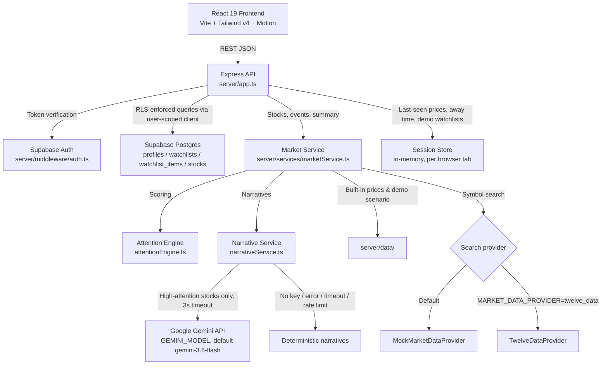
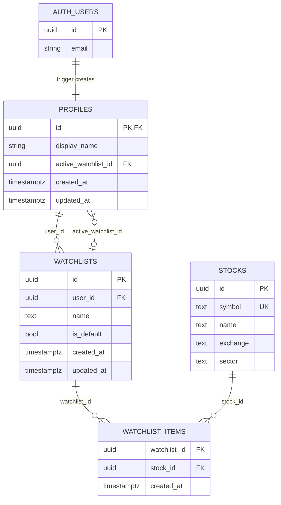

# Nazar - Keep an eye on what matters.

### Code, by Groww 2026 Submission

Nazar is a smart market watchlist built around a single question: **"What changed while I was away, and does it actually matter?"**

A conventional watchlist answers *"what is the current price?"*. Nazar answers *"what moved, why it moved, and whether that movement is worth your attention right now"* — personalised to the exact window of time since your last visit. It does this through a deterministic, multi-factor Attention Scoring Engine that runs server-side on every request, combined with a server-side price snapshot (kept per browser tab) that stores where prices were when you last checked.

> **Data note:** prices, indices and timeline events come from a built-in, simulated demo dataset — they are not live market data, and the app labels them as "Simulated data".

## LIVE DEPLOYED LINK - https://groww-pulse-iota.vercel.app/


---

## 1. Product Overview

### The Problem with Conventional Watchlists

A standard watchlist shows you current prices. It does not tell you:
- Whether a 2% move happened *during* your absence or *before* it
- Whether that 2% is significant relative to this stock's normal volatility
- Whether volume confirmed the move or not
- Whether a gap-up that subsequently reversed is more important than a steady upward grind
- Which of your 12 tracked stocks actually deserves your attention right now

The result: users scan their entire watchlist on every visit, manually comparing prices they half-remember from yesterday. That cognitive overhead compounds across sessions.

### What Nazar Does Differently

When a user returns to Nazar, the system:
1. **Measures the time elapsed** since their last session (or a simulated absence)
2. **Compares current market state against a price snapshot** taken at their last visit — not just against yesterday's close
3. **Runs a proprietary Attention Score** (0–100) for every watched stock, factoring in volume, volatility, technical breakouts, intraday reversals, and the personal delta since the user's last check
4. **Surfaces a ranked, filterable view** of what changed meaningfully, ordered by attention score
5. **Generates a human-readable narrative** (via Google Gemini or a deterministic fallback) explaining *why* a move matters

The output is a prioritised briefing, not a raw price feed.

### Primary User Journey

```
User visits Nazar
  → Signs in (or skips auth for demo mode)
  → A new browser tab starts in the canonical demo state: "away 7h 42m", baseline = yesterday's closes
  → User browses the watchlist, then leaves

[Time passes — market moves]

User returns
  → Nazar calculates elapsed time since last visit
  → Compares current prices against stored snapshot prices
  → Runs Attention Engine on every watched stock
  → Presents sorted list: highest-attention stocks first
  → The briefing shows "Away: 7h 42m" and "3 things changed meaningfully"
  → User opens any stock → sees "Last seen ₹2,341.50 → Now ₹2,431.20 (+3.83%)" + why it matters
  → User can acknowledge, dismiss, or deep-dive events
  → User clicks "Mark Session as Read" (feed status menu) → current prices become the new baseline
```

---

## 2. Core Features

### Watchlist Management
Create and switch between multiple named watchlists, and add or remove stocks from a searchable universe (currently 14 symbols across NSE and NASDAQ). The selected watchlist is remembered across reloads. For authenticated users the default watchlist is created on first use by a PostgreSQL RPC with seven NIFTY 50 stocks plus AAPL and MSFT. Deleting and renaming watchlists is supported by the API but has no UI yet.

### Nazar Hero
The primary entry screen. It shows a greeting, the number of meaningful changes ("3 things changed meaningfully", score ≥ 65), a stat strip (average watchlist change, high-attention symbols, most volatile symbol), and up to four ranked cards: a flagship card for the highest-attention stock plus up to three more. This is the "what happened while I was away" answer.

### Attention Score (0–100)
Every stock receives a score computed deterministically on every API call. It combines five independent signal groups. Stocks are sorted by score descending. On the briefing, the **What matters** filter shows stocks scoring ≥ 55 (always including the top stock); **All** shows every stock.

### Price Delta Since Your Last Visit
Every stock card shows the price when you last checked and the current price — not just yesterday's close. The baseline is kept server-side per browser tab (see [Persistence](#8-persistence--state-management)).

### Change Timeline
A chronological event feed showing *what happened and when* within your absence window — only events that happened while you were away are shown, with times in IST. Each event has a mini price chart and an explanation, can be acknowledged or dismissed, and can be filtered (All Events / Critical / Breakouts / Surges). The timeline is scoped to the active watchlist.

### Stock Detail Modal
Deep-dive on any stock: multi-timeframe SVG price charts (1D/1W/1M/1Y/ALL; hover shows a time for 1D and dates for longer ranges), volume bars, 30-day volume multiple, 30-day high, daily volatility, 52-week range, market cap, recent events, and a "why it matters" explanation. If loading fails it shows the error with a **Try again** button. Prices are shown in ₹ for NSE stocks and $ for NASDAQ stocks.

### AI Explanation Layer (Google Gemini)
For high-attention stocks, Gemini (`gemini-3.6-flash` by default, configurable with `GEMINI_MODEL`) writes a concise 1–2 sentence narrative of the price action. The model receives only pre-computed, deterministic facts — it is used as a natural-language renderer, never as a data source. If Gemini is not configured, slow (3-second timeout), unavailable or rate-limited, a deterministic narrative built from the same facts is served instead.

### Time Travel Simulator
A developer/demo tool that sets the simulated `lastVisitTimestamp` to a chosen distance in the past (15m, 2h, 7h 42m, 24h, 3 days). It also rewinds the last-seen prices for that session, so the entire Attention Engine reacts as if you had been away for that period, and the timeline shows only the events inside that window. This allows the full "you were away" flow to be demonstrated without waiting.

### Authentication + Demo Mode
Supabase Auth (email/password) with server-side JWT verification. Watchlist data for signed-in users goes through a user-scoped Supabase client, so Row-Level Security limits every query to the user's own data.

Demo mode runs on an in-memory, per-browser-tab session on the server, with no account:
- **"Skip for now"** on the sign-in screen enters demo mode for that tab (it survives a reload; the header's sign-out button becomes **Exit demo**). The server must also run with `VITE_DEMO_MODE=true` to accept requests without a token.
- **`VITE_DEMO_MODE=true`** opens the app without sign-in.
- **No Supabase configuration at all** also runs the app in demo mode on both client and server.

---

## 3. What Counts as a "Meaningful Change"?

This is the core engineering problem Nazar addresses. The answer is implemented in `calculateAttention()` in [`server/services/attentionEngine.ts`](./server/services/attentionEngine.ts).

### Scoring Model

Every stock starts at a baseline score of **20**. Five independent factor groups (one rule per group can fire) add points. The score is capped at **98** for realism (a score of 100 would imply perfect information).

| Factor | Condition | Points Added |
|--------|-----------|-------------|
| **Volume Surge** | Volume ≥ 2.0× 30-day average | `min(35, round(ratio × 14))` |
| **Elevated Volume** | Volume between 1.4×–1.99× average | +15 |
| **Volatility Shock** | Price move ≥ 2.5× the stock's historical daily volatility | `min(30, round(multiple × 10))` |
| **Price Momentum** | Absolute price change ≥ 1.5% | +15 |
| **30-day High Breakout** | Current price ≥ 30-day high | +28 |
| **Near-High** | Within 1.5% of 30-day high | +18 |
| **Intraday Gap Reversal** | Opened >0.8% above close, then fell >1.5% below close | +26 |
| **User Delta** | Price moved ≥ 2.5% since user's last visit (personal) | +16 |

**Score → Level mapping** (`attentionLevel`):
- ≥ 75: `high` — the only level that may use Gemini for its narrative
- 50–74: `medium`
- < 50: `low`

Other thresholds used by the UI and summary: ≥ 65 counts as a "meaningful change" in the briefing headline, ≥ 70 is listed under "High Attention", and ≥ 55 passes the **What matters** filter.

### Why These Signals?

**Volume is a conviction proxy.** A 3% price move on 2.4× normal volume means institutional participants were actively involved. The same 3% move on 0.8× volume is speculative noise. Volume weighting is the single most important differentiator from a naive percentage-change sort.

**Volatility normalisation prevents misleading rankings.** A 2% move in HDFCBANK (typical daily range: 1.45%) is a 1.38× volatility event. A 2% move in BHARTIARTL (typical daily range: 1.10%) is a 1.82× volatility event. Raw percentage ranking would treat these equally; the scoring engine doesn't.

**The 30-day high breakout is a level that the market has repeatedly tested and failed to sustain.** When price clears it with volume, that's technically significant. This is a standard institutional trigger level.

**The intraday gap reversal is specifically a bearish signal.** A stock that opens higher (gap-up) but closes below the previous day's close on high volume signals strong distribution — institutional selling into retail optimism. This is one of the highest-information patterns for risk management. It warrants +26 points because the signal is specific, time-bounded, and not captured by simple daily percentage change.

**The user-personal delta** ensures that a stock which moved sideways for two days and then surged during *your specific* absence gets credit for that surge relative to your snapshot — even if the 24-hour change number looks modest.

### What is Not Counted as Meaningful

- Normal range fluctuation below thresholds
- News events without price/volume confirmation (no news API is integrated)
- Options data, FII/DII flows, or order book depth (not in the current data model)

---

## 4. User Experience

### Auth Flow
Landing screen presents email/password sign-in and sign-up. Errors are specific where possible (wrong credentials, rate limits, unconfirmed email). "Check your email" is shown only when Supabase requires email confirmation. A "Skip for now" link at the bottom of the card activates demo mode — the user enters the full application immediately using server-side in-memory session data. There is no password-reset flow yet.

### Navigation
Four tabs in the header: **Nazar** (briefing + watchlist), **Watchlist** (watchlist standalone), **Timeline** (chronological event feed), **Indices** (NIFTY 50, SENSEX, BANK NIFTY, GIFT NIFTY cards).

### Watchlist View
Stocks are listed as rows with: symbol, exchange, a volume badge for unusual volume, top scoring factor, the delta since your last visit, current price, 24h change, and the colour-coded attention score. Rows can be filtered and sorted by attention, % move, volume or symbol; by default high-attention stocks float to the top. An empty watchlist shows suggested stocks to add. The remove button appears on hover or keyboard focus, and is always visible on touch screens.

### Stock Card → Why Modal
Each stock card has a "Why?" button that opens the `AttentionWhyModal`. This explains the score factors with individual point contributions and a plain-English summary of why the stock matters.

### Command Search
`Cmd/Ctrl+K` toggles a keyboard-driven command palette: search by symbol, company name, sector or tag (with quick filters: Tata, Banking, Tech, Energy, EV), open a stock with ↑/↓ and Enter, or add/remove it from the current watchlist. Search is debounced and ignores out-of-order responses.

### Accessibility
Dialogs trap keyboard focus and return it to the opener when closed, and Escape closes only the topmost dialog or popover. Watchlist rows, briefing cards, timeline cards and the header controls are reachable with Tab and open with Enter/Space; search results are navigated with the arrow keys. With the OS "reduce motion" setting, animations are disabled and the background and intro canvases draw a single static frame.

---

## 5. System Architecture



### Component Responsibilities

| Component | Responsibility |
|-----------|---------------|
| `server/app.ts` | Express app: security headers, every API route, JSON 404 for unknown `/api` routes, error handler |
| `server/index.ts` | Local entry point: starts the HTTP server with Vite (dev) or the built frontend (prod) |
| `api/index.ts` | Vercel serverless entry point; re-exports the Express app |
| `server/config.ts` | Reads Supabase settings lazily; decides demo mode (`VITE_DEMO_MODE=true` or Supabase not configured) |
| `server/validation.ts` | Request validation: watchlist names, symbols, IDs, query strings, away duration |
| `server/errors.ts` | `ClientError` and the error handler: business-rule errors keep their message, anything else returns a generic 500 |
| `server/services/marketService.ts` | Builds enriched stocks, timeline events, the "while you were away" summary, stock detail and feed status |
| `server/services/attentionEngine.ts` | The deterministic Attention Score |
| `server/services/narrativeService.ts` | Gemini narratives with timeout, request sharing, caching and deterministic fallbacks; `/api/explain` text |
| `server/services/sessionStore.ts` | Per-tab in-memory session: last-seen prices, away duration, time travel, sync, demo reset; idle expiry and size cap |
| `server/db/supabaseRepository.ts` | All Supabase database operations; user-scoped clients enforce RLS |
| `server/middleware/auth.ts` | JWT Bearer verification with Supabase Auth; demo-mode bypass |
| `server/data/` | Stock universe and the canonical demo scenario (indices, events, watchlists) |
| `server/providers/` | Symbol search providers and generated chart history |
| `src/services/api.ts` | Frontend API client; attaches the Supabase token and the per-tab session ID; throws on non-2xx responses |
| `src/contexts/AuthContext.tsx` | Supabase auth state; exposes `user`, `isDemoMode`, `canExitDemo`, `setDemoMode()` |
| `src/lib/` | Supabase client (optional), auth helpers, currency symbol, serial edit queue, pulse acknowledge helpers, Escape-key and focus-trap hooks |
| `src/components/` | React UI components; receive data and callbacks as props |

---

## 6. Technology Stack

| Layer | Technology | Reason |
|-------|-----------|--------|
| Frontend framework | React 19 | Concurrent features, stable ecosystem |
| Build tool | Vite 6 | Sub-second HMR, ESM-native, unified dev server |
| Backend framework | Express 4 | Minimal, well-understood, no magic |
| Language | TypeScript 5.8 (strict) | Full-stack type safety; shared `types.ts` between frontend and backend |
| Security headers | helmet | Standard HTTP security headers; Content Security Policy in production builds |
| Styling | Tailwind CSS v4 | Utility-first; CSS variable design tokens for theming |
| Animations | Motion (`motion/react`) | Declarative `AnimatePresence` for modal transitions and stagger effects |
| Database | Supabase (Postgres) | Managed Postgres with built-in Auth and Row-Level Security; eliminates a separate auth service |
| Authentication | Supabase Auth | Email/password with JWT; JWTs verified server-side on every request |
| AI / LLM | Google Gemini (default `gemini-3.6-flash`) | Narrative text only; structured fact injection prevents hallucination |
| Symbol search (optional) | Twelve Data REST API | Free symbol-search endpoint |
| Market data | Built-in deterministic dataset | Zero API dependency for demos; realistic, reproducible data |
| Icons | Lucide React | Consistent, lightweight |
| Dev runner | tsx | Runs the TypeScript server directly in dev without a build step |
| Production build | Vite + esbuild | Vite bundles the SPA; esbuild bundles the server into `dist-server/server.cjs` (kept out of the public `dist/` folder) |
| Formatting | Prettier | One consistent code style (`npm run format`) |
| Linting | ESLint + typescript-eslint + react-hooks | Catches hook dependency mistakes and common bugs (`npm run lint`) |
| Tests | Node test runner via tsx | Regression tests with no extra test framework (`npm test`) |

---

## 7. Data Flow

### A. User Loads a Watchlist

```
Frontend: loadMarketData()
  → On first load only: GET /api/market/indices, /api/market/status, /api/market/stocks/all
    (static data — not re-fetched by polling)
  → GET /api/watchlists (with Bearer token)
     → requireAuth (server/middleware/auth.ts) validates the JWT with Supabase Auth
     → supabaseRepository.getWatchlists(token)
        → Creates user-scoped Supabase client (RLS enforced)
        → Calls ensure_default_watchlist() RPC (idempotent, race-safe)
        → Fetches watchlists + nested watchlist_items + stocks via Supabase join query
        → Fetches active_watchlist_id from profiles table
        → Returns formatted watchlists array + activeId
  → GET /api/market/stocks?watchlistId=X
     → marketService.getStocks(session, symbols)   (an empty watchlist returns no stocks)
        → For each symbol: computes attention score, user delta, sparkline, narrative
     → Returns enriched Stock[] array
  → GET /api/market/pulse?watchlistId=X
  → GET /api/market/events?watchlistId=X
    (these three resolve the watchlist without calling ensure_default_watchlist again)

Frontend: applies the results only if no newer load or edit started meanwhile,
          then polls again in 15 seconds (4 requests; skipped while the tab is hidden,
          refreshed as soon as it becomes visible)
```

### B. User Adds a Stock

```
Frontend: handleAddStock(symbol)
  → Adds the symbol to the local watchlist immediately (optimistic)
  → Queues PUT /api/watchlists/:id { symbols: [...latest symbols] }
    (edits run one at a time, in order, each sending the latest symbol list)
     → server/validation.ts checks and normalises the symbols (upper-case, de-duplicated, max 100)
     → supabaseRepository.updateWatchlist(token, id, undefined, newSymbols)
        → Calls replace_watchlist_items() RPC atomically
           → Deletes all existing watchlist_items for this watchlist
           → Re-inserts all items (including new symbol) by resolving symbol → stock UUID
           → All inside a single PL/pgSQL function for atomicity
  → On failure: rolls back the optimistic change
  → Frontend re-calls loadMarketData(activeWatchlistId)
```

Note: add/remove is implemented as a full symbol-set replace via an atomic RPC, sent through a client-side queue so rapid edits cannot overwrite each other. Renaming without changing symbols updates the row directly and leaves the items untouched.

### C. User Returns After Absence

The "return" flow is implicit — the attention engine does the work on every `/api/market/stocks` call.

```
session.lastVisitTimestamp   ← set by "Mark Session as Read", time travel, or the demo reset (7h 42m ago)
session.stockSnapshots       ← { symbol: { price, timestamp } } for each stock

GET /api/market/stocks
  → For each stock:
     previousPrice = stockSnapshots[symbol].price
     currentPrice  = BASE_STOCKS[symbol].basePrice
     priceDiff     = currentPrice - previousPrice
     percentDiff   = (priceDiff / previousPrice) × 100
     awayStr       = formatDuration(simulatedAwaySeconds)
  → calculateAttention() runs with previousPrice
  → Stock returned with attentionScore + userDelta { previousPrice, currentPrice, percentDiff, narrative }

Frontend sorts stocks by attentionScore descending
MarketPulseHero shows "Away: X", the meaningful-change count and the ranked cards
```

### D. External Services Fail

- **Gemini** errors, `429` rate limits and calls taking longer than 3 seconds are caught in the narrative service, which then returns a deterministic narrative. Concurrent requests for the same narrative share one Gemini call. Fallbacks are cached for only 30 seconds so Gemini is retried soon after it recovers.
- **Twelve Data search** failures (HTTP or network errors) return an empty result list.
- **Supabase seeding** on startup is fire-and-forget: a failure is logged and the server keeps running. Without a secret key, or without Supabase configured, seeding is skipped.
- **Supabase Auth** errors while verifying a token return HTTP 503 instead of leaving the request hanging.

If the backend itself fails, the API client throws on any non-2xx response; the frontend catches and logs it, and the UI keeps the last state it successfully loaded (no hard crash, no blank screen). The stock detail modal shows the error with a **Try again** button.

---

## 8. Persistence & State Management

### Authenticated Users (Supabase)

| What | Where | How |
|------|-------|-----|
| Watchlist structure (name, symbols) | Supabase `watchlists` + `watchlist_items` tables | Persists across sessions and devices |
| Active watchlist selection | Supabase `profiles.active_watchlist_id` | Saved on every watchlist switch; must point at one of the user's own watchlists (enforced by a trigger) |
| Stock master data | Supabase `stocks` table | Seeded on server startup via the admin client |
| User identity | Supabase Auth (email/password, JWT) | Standard token refresh flow |

### Server Session (In-Memory, per Browser Tab)

Each tab sends an `X-Session-Id` header; the server keeps one `UserSession` per ID in `server/services/sessionStore.ts`. Last-seen prices, away time and event acknowledgements live here **for signed-in users too**; watchlists live here only in demo mode.

| What | Field | Notes |
|------|-------|-------|
| Watchlists (demo mode) | `watchlists` | Lost on server restart |
| Active watchlist (demo mode) | `activeWatchlistId` | Same |
| Last-seen price snapshot | `stockSnapshots` | `{ price, timestamp }` per symbol |
| Last visit timestamp | `lastVisitTimestamp` | Unix ms; controls the away-duration calculation |
| Dismissed/acknowledged events | `dismissedEventIds` / `acknowledgedEventIds` | Cleared by demo reset |

Sessions expire after 6 hours without requests, at most 5,000 are kept (least recently used are evicted first), and session IDs are truncated to 64 characters.

### Client-Side

| What | Where |
|------|-------|
| Intro seen flag | `localStorage.nazar_intro_seen` |
| Per-tab session ID | `sessionStorage.nazar_session_id` |
| Demo scenario initialised flag | `sessionStorage.nazar_demo_initialized` |
| "Skip for now" demo choice | `sessionStorage.nazar_demo_override` |
| Auth session token | Managed by the Supabase client library |

**The price snapshot baseline** is managed server-side, not in the browser, so it survives page refreshes within the same tab (but not a server restart, or another serverless instance). "Mark Session as Read" calls `/api/session/sync`, which makes the current prices the new baseline.

---

## 9. Reliability & Edge Cases

### Invalid or Unknown Stock Symbol
`/api/market/stocks/:symbol` returns HTTP 404 for a symbol outside the 14-stock universe. Search results are also limited to that universe.

### Empty Watchlist
An empty watchlist returns no stocks, events or summary counts (only an omitted symbol list means "all stocks"), and the UI shows suggested stocks to add.

### Duplicate Stock in Watchlist
Prevented client-side: `handleAddStock` checks the latest symbols before calling the API. Prevented server-side by symbol validation (de-duplication) and by the `replace_watchlist_items` RPC which does a `DELETE + INSERT ... ON CONFLICT DO NOTHING`.

### Deleting the Only / Default Watchlist
Both modes refuse to delete the default watchlist (HTTP 400). In Supabase mode `supabaseRepository.deleteWatchlist()` checks `is_default` first; in demo mode the server also returns 404 for an unknown ID and refuses to delete the last watchlist. Deleting a non-active watchlist keeps the current selection; deleting the active one falls back to the first remaining list.

### Default Watchlist Creation
`ensure_default_watchlist()` takes a per-user advisory lock and a unique partial index allows at most one default watchlist per user, so concurrent first loads cannot create duplicates. Only this function can set `is_default`: signed-in users have column privileges for `name` only, and `create_watchlist_with_items` ignores its `p_is_default` argument.

### Authentication Failure
`server/middleware/auth.ts` returns HTTP 401 with a structured error body, or 503 if token verification itself fails. The frontend's `api.ts` throws on any non-2xx response; the error is caught and logged, and the UI keeps its last state (it does not redirect). The `AuthContext` handles token expiry via Supabase's `onAuthStateChange` listener, which will set `user` to `null` and cause `AuthGate` to render `<AuthScreen />`.

### Invalid Input and Errors
`server/validation.ts` checks request input and answers HTTP 400 when it is invalid:
- **Watchlist names** must be non-empty strings; they are trimmed and cut to 50 characters.
- **Symbols** must be an array of at most 100 tickers. Each is 1–20 characters of letters, digits and `.&_-`, and is upper-cased.
- **Watchlist IDs** are checked.
- **Search queries** must be a single string.
- **`awaySeconds`** must be a number from 0 to 30 days. Malformed JSON returns `400 Invalid JSON body`. Unexpected errors are logged server-side and returned as a generic message without internals or stack traces. Unknown `/api` routes return a JSON 404.

### Concurrent Watchlist Updates
On the client, watchlist edits go through a serial queue and each sends the latest symbol list; a load only applies its results if no newer load, watchlist switch or edit started meanwhile. On the server, the `replace_watchlist_items` PostgreSQL RPC replaces items atomically inside a single PL/pgSQL transaction. There is no optimistic locking on the watchlist itself.

### AI Narrative Failure
If Gemini fails for any reason (API error, 3-second timeout, rate limit, empty response), the narrative service returns a deterministic narrative built from the pre-computed facts. The user always receives a narrative.

### Security Headers
`helmet` sets the standard security headers and removes `X-Powered-By`. Production builds also send a Content Security Policy that only allows this origin, Google Fonts and Supabase; `vercel.json` sets the same headers for static files on Vercel.

### Known Limitations

- **Server-side sessions are process-scoped**: with multiple Node.js instances (or serverless cold starts), the in-memory sessions (last-seen prices, time travel, demo watchlists) are not shared. Authenticated users' watchlists are not affected since they live in Supabase.
- **No real-time WebSocket feed**: The frontend polls every 15 seconds. There is no push mechanism for instant price updates.
- **Prices come from the built-in dataset**: current prices, volumes and ranges are defined in `server/data/stockUniverse.ts` and never change. `MARKET_DATA_PROVIDER=twelve_data` only switches symbol search to Twelve Data, and results outside the 14-stock universe are dropped.
- **Chart history is generated**: 1D/1W/1M/1Y charts are deterministic, seeded series from `MockMarketDataProvider`; **ALL** shows the same data as 1Y. The day range is the open and current price.
- **Last-seen prices are not persisted for authenticated users**: snapshots live in the in-memory session. The correct fix would be to persist them per user in the `profiles` table.
- **14 supported symbols**: adding a symbol means adding it to `BASE_STOCKS` in `server/data/stockUniverse.ts`.
- **Event feed is deterministic**: The Change Timeline events are scripted scenarios, not computed from live data.
- **No password reset, and no UI for renaming or deleting watchlists** (the API supports both).

---

## 10. Engineering Decisions & Trade-offs

### Unified Express + Vite Server

**Decision:** Locally, a single Node.js process (`server/index.ts`) serves both the Express API and the Vite dev middleware; in production it serves the built SPA from `dist/`. On Vercel, `api/index.ts` exposes the same Express app as a serverless function.

**Why:** Eliminates CORS configuration, simplifies deployment (one container, one port), and avoids managing two separate processes during development.

**Trade-off:** The server and frontend are coupled in one process. You cannot independently scale the API from the static file serving layer. For a hackathon where the deployment target is a single container, the simplicity benefit clearly outweighs the scalability cost.

---

### Attention Engine on the Server, Not the Client

**Decision:** All score calculation happens in `server/services/attentionEngine.ts`, not in the browser.

**Why:** The engine needs access to authoritative baseline data (30-day averages, historical volatility, user snapshot prices). Keeping this computation server-side ensures all clients see a consistent score for the same stock, prevents score manipulation via client-side modification, and keeps the type model simple (the client receives a pre-computed `attentionScore` field).

**Trade-off:** Every API call recalculates scores from scratch. There is no incremental update mechanism. For 14 stocks, this is instantaneous. For a watchlist of 200+ stocks, this would become a measurable bottleneck.

---

### `MarketDataProvider` Interface for Symbol Search

**Decision:** Symbol search sits behind a small `MarketDataProvider` interface with two implementations — `MockMarketDataProvider` (default) and `TwelveDataProvider` — selected with `MARKET_DATA_PROVIDER`.

**Why:** The demo works without any API key, and the data source can be swapped without touching the scoring or UI code.

**Trade-off:** Only search is behind the interface today; prices still come from the built-in dataset. Live quotes would be the next method to add to the interface.

---

### Atomic PostgreSQL RPCs for Watchlist Mutations

**Decision:** Watchlist creation (`create_watchlist_with_items`), item replacement (`replace_watchlist_items`) and default-watchlist creation (`ensure_default_watchlist`) are implemented as PL/pgSQL functions called via Supabase RPC, not as sequences of client-initiated API calls. (A rename without symbol changes is a plain row update.)

**Why:** A watchlist update involves deleting all existing items and reinserting the new set. If this is done as two separate API calls, a crash between calls leaves the watchlist in a corrupt empty state. A single PL/pgSQL transaction either fully completes or fully rolls back.

**Trade-off:** Business logic lives in the database, which makes it harder to test in isolation and creates a tight coupling between the application and Supabase specifically. The trade-off was intentional — data integrity was prioritised over portability.

---

### Gemini as an Explanation Layer, Not a Data Source

**Decision:** Gemini receives only pre-computed facts (price, percentage change, volume ratio, detected scoring factors). It is asked only to render these facts in natural language. It is never asked to retrieve data, estimate prices, or make predictions.

**Why:** LLMs hallucinate financial numbers. A model that invents a price movement that didn't happen would be actively harmful in a financial context. Separating the deterministic calculation layer from the language layer means the prompt only ever contains verified numbers.

**Trade-off:** The narrative is less "intelligent" — Gemini can only rephrase what it was given. It cannot notice patterns, surface context from its training data, or explain macroeconomic causes. That is the correct trade-off: reliability over apparent sophistication.

---

### Demo-First Architecture

**Decision:** Every new session starts in a canonical "7h 42m away" state, including pre-set price snapshots and market events (`server/data/demoScenario.ts`). `POST /api/demo/reset` restores this state, and the frontend calls it on each tab's first visit.

**Why:** Hackathon judges need to see the "you were away" experience immediately, without having to wait and come back. The canonical scenario is specifically designed to demonstrate all three attention score paths simultaneously: price surge with volume (RELIANCE), technical breakout (TCS), and intraday reversal (HDFCBANK).

**Trade-off:** The demo state is a fiction. The seeded prices and events are scenarios. This is acceptable for a demonstration submission but would require a complete rethink for production, where the baseline state would come from live data and real user behaviour.

---

## 11. AI / Intelligence Layer

### Where AI Is Used

`buildStockNarrative()` in `server/services/narrativeService.ts` — called by `getStocks()` for every stock. It uses Gemini only when `GEMINI_API_KEY` is set, `GEMINI_ENABLED` is not `false`, and the stock's attention level is `high` (to preserve free-tier quota). The model is `gemini-3.6-flash` unless `GEMINI_MODEL` is set. All other cases get a deterministic narrative built from the computed change, volume and attention factors (e.g. "Since your last visit (7h 42m ago), TCS rose 1.9% to 4,128.50, on 1.6× its normal volume, trading above its 30-day high of 4,110.").

### Input and Output

**Input (facts injected into the prompt):** stock symbol, current price, percentage change since the last visit, volume relative to normal, and the labels of the detected scoring factors.

**Rules in the prompt:** no financial advice, no calculations (use only the data provided), at most two sentences, focus on why the move matters.

### Caching and Fallback

An in-memory cache (`narrativeCache`, at most 500 entries) keeps Gemini narratives for 2 minutes to avoid redundant calls within a polling window. The cache key includes every input (symbol, last-seen and current price, volume ratio, away time, attention level), so sessions with different baselines never share text. Deterministic fallbacks are cached for only 30 seconds so the app switches back to Gemini soon after it recovers. Gemini calls time out after 3 seconds, and concurrent requests for the same narrative share one call.

The "Why it matters" text in the stock modals comes from `POST /api/explain`, which returns a deterministic one-sentence explanation built from the facts sent by the client (`buildExplanation()`: change since the last visit, volume multiple, time away).

### What Is Not AI

The Attention Score (0–100) is **not AI**. It is a deterministic rule-based weighted sum of five signal groups. Each condition has an explicit threshold and a fixed point value. There is no ML model, no trained weights, and no probabilistic component. The score for any given combination of inputs is always the same.

---

## 12. API Design

| Method | Endpoint | Purpose | Auth Required |
|--------|----------|---------|--------------|
| `GET` | `/api/health` | System health, search provider, Gemini availability | No |
| `GET` | `/api/market/indices` | NIFTY 50, SENSEX, BANK NIFTY, GIFT NIFTY | No |
| `GET` | `/api/market/status` | Data feed status shown in the header (`SIMULATED`) | No |
| `GET` | `/api/market/stocks/all` | All 14 stocks (for search/add flow) | No |
| `GET` | `/api/market/search?q=` | Search by symbol, name, sector or tag | No |
| `GET` | `/api/market/stocks?watchlistId=` | Enriched stocks for active watchlist | Yes |
| `GET` | `/api/market/stocks/:symbol` | Extended stock detail with charts | No |
| `GET` | `/api/market/pulse?watchlistId=` | MarketPulse summary object | Yes |
| `GET` | `/api/market/events?watchlistId=` | Change Timeline events | Yes |
| `POST` | `/api/market/events/:id/acknowledge` | Mark event as seen | No |
| `POST` | `/api/market/events/:id/dismiss` | Remove event from feed | No |
| `GET` | `/api/watchlists` | All watchlists for user | Yes |
| `POST` | `/api/watchlists` | Create watchlist | Yes |
| `PUT` | `/api/watchlists/:id` | Update name, symbols, or active status | Yes |
| `DELETE` | `/api/watchlists/:id` | Delete watchlist | Yes |
| `POST` | `/api/explain` | One-sentence "why it matters" explanation from facts | No |
| `POST` | `/api/session/time-travel` | Simulate time elapsed (`preset` or `awaySeconds`) | No |
| `POST` | `/api/session/sync` | Reset baseline to current prices | No |
| `POST` | `/api/demo/reset` | Restore canonical 7h 42m demo state | No |

Authentication is Bearer JWT. All authenticated routes extract the token via `requireAuth` (`server/middleware/auth.ts`), verify it with Supabase Auth, and attach `req.user` and `req.token` to the request. An invalid token returns 401; a failure of the verification service returns 503. Authenticated routes that receive a valid token use a user-scoped Supabase client (RLS enforced). In demo mode (`VITE_DEMO_MODE=true`, or Supabase not configured), requests without a token fall through to the in-memory session for that browser tab (`X-Session-Id` header).

Responses are JSON. Invalid input returns 400 with an `error` message, unknown `/api` routes return 404, and unexpected failures return a generic 500 message (details are only logged on the server).

---

## 13. Database Design

### Tables



### Row-Level Security

All tables have RLS enabled. Policies enforce that users can only read and change their own profile, watchlists and watchlist items (via `auth.uid()`). The `stocks` table is readable by all authenticated users but writable only via the admin client (server-side seeding).

On top of RLS:
- **Column privileges on `watchlists`.** Signed-in users may insert only `user_id` and `name`, and update only `name` and `updated_at`, so they cannot set `is_default`.
- **Unique partial index `watchlists_one_default_per_user`.** At most one default watchlist per user.
- **Trigger `profiles_active_watchlist_owner`.** `profiles.active_watchlist_id` must reference one of the profile owner's own watchlists.

### PostgreSQL Functions (RPCs)

| Function | Purpose |
|----------|---------|
| `handle_new_user()` | Trigger: creates a `profiles` row when a new `auth.users` entry is inserted |
| `create_watchlist_with_items(name, symbols, is_default)` | Atomically creates a (non-default) watchlist and resolves symbol strings to stock UUIDs for items; `is_default` is ignored |
| `ensure_default_watchlist()` | Idempotent and race-safe (`SECURITY DEFINER`, per-user advisory lock): creates the default watchlist with preset symbols if the user has none |
| `replace_watchlist_items(watchlist_id, name, symbols)` | Atomically replaces all items in a watchlist (delete + re-insert) |
| `check_active_watchlist_owner()` | Trigger function behind `profiles_active_watchlist_owner` |

---

## 14. Project Structure

```text
├── api/
│   └── index.ts                       # Vercel serverless entry (re-exports the Express app)
├── server/
│   ├── index.ts                       # Local entry: HTTP server + Vite (dev) / built SPA (prod)
│   ├── app.ts                         # Express app: security headers, every API route, error handling
│   ├── config.ts                      # Supabase settings and demo-mode detection
│   ├── validation.ts                  # Request input validation
│   ├── errors.ts                      # ClientError + JSON error handler (no stack traces)
│   ├── middleware/
│   │   └── auth.ts                    # JWT verification with Supabase Auth, demo-mode bypass
│   ├── db/
│   │   └── supabaseRepository.ts      # All Supabase queries (user-scoped clients enforce RLS)
│   ├── services/
│   │   ├── marketService.ts           # Enriched stocks, events, "while you were away" summary, stock detail
│   │   ├── attentionEngine.ts         # Attention Score (0–100)
│   │   ├── narrativeService.ts        # Gemini narratives + deterministic fallbacks
│   │   └── sessionStore.ts            # In-memory per-tab sessions, time travel, sync, demo reset
│   ├── data/
│   │   ├── stockUniverse.ts           # The 14 supported stocks and their reference data
│   │   └── demoScenario.ts            # Canonical demo: indices, timeline events, watchlists
│   ├── providers/
│   │   ├── types.ts                   # MarketDataProvider interface and data types
│   │   ├── MockMarketDataProvider.ts  # Built-in search + generated chart history
│   │   └── TwelveDataProvider.ts      # Symbol search via the Twelve Data API
│   └── utils/
│       └── formatDuration.ts          # 27720 seconds → "7h 42m"
│
├── src/
│   ├── main.tsx                       # React entry point
│   ├── App.tsx                        # Auth gate, app state, data loading, layout
│   ├── types.ts                       # Types shared by frontend and backend
│   ├── index.css                      # Design tokens and global styles
│   ├── services/
│   │   └── api.ts                     # Frontend API client
│   ├── lib/
│   │   ├── supabase.ts                # Supabase browser client (null when not configured)
│   │   ├── auth.ts                    # signIn / signUp / signOut helpers, error messages
│   │   ├── currency.ts                # ₹ / $ by exchange
│   │   ├── serialQueue.ts             # Runs watchlist edits one at a time, in order
│   │   ├── pulseAck.ts                # Maps briefing cards to the timeline events they acknowledge
│   │   ├── useEscapeKey.ts            # Escape closes only the topmost dialog/popover
│   │   └── useFocusTrap.ts            # Keeps focus inside open dialogs, restores it on close
│   ├── contexts/
│   │   └── AuthContext.tsx            # Auth state provider, demo mode
│   └── components/
│       ├── Header.tsx                 # Navigation tabs, feed status, controls
│       ├── MarketIndicesBar.tsx       # Index strip under the header
│       ├── MarketPulseHero.tsx        # "While you were away" briefing + top attention cards
│       ├── IntelligentWatchlist.tsx   # Watchlist table with filter, sort, add/remove
│       ├── ChangeTimeline.tsx         # Chronological event feed
│       ├── StockDetailModal.tsx       # Charts, metrics and events for one stock
│       ├── AttentionWhyModal.tsx      # Score factor breakdown
│       ├── CommandSearch.tsx          # Cmd/Ctrl+K command palette
│       ├── TimeTravelModal.tsx        # Away-duration simulator
│       ├── CreateWatchlistModal.tsx   # New watchlist form
│       ├── AuthScreen.tsx             # Sign in / sign up + "Skip for now"
│       ├── FirstOpenExperience.tsx    # Intro animation
│       ├── AtmosphereField.tsx        # Background particles
│       ├── AnimatedPrice.tsx          # Price that flashes on change
│       ├── Sparkline.tsx              # Inline SVG mini chart
│       └── ErrorBoundary.tsx          # React error boundary
│
├── supabase/migrations/
│   ├── 20260905000001_create_profiles.sql    # profiles table, RLS, sign-up trigger
│   ├── 20260905000002_create_watchlists.sql  # stocks / watchlists / items, RLS, RPCs
│   ├── 20261027000001_one_default_watchlist_per_user.sql      # race-safe default watchlist
│   ├── 20261027000002_server_controlled_default_watchlist.sql # clients cannot set is_default
│   └── 20261027000003_active_watchlist_ownership.sql          # active watchlist must be your own
│
├── tests/                             # Regression tests (npm test)
├── public/                            # Logo and favicon
├── index.html                         # HTML entry; Google Fonts (Roboto)
├── vite.config.ts                     # Vite config (React + Tailwind v4 plugins)
├── vercel.json                        # Routes /api/* to the serverless function; security headers
├── tsconfig.json                      # TypeScript config (strict)
├── eslint.config.js                   # ESLint config (TypeScript + React hooks)
├── .prettierrc                        # Code formatting rules
├── .env.example                       # Environment variable template
└── FIX_REPORT.md                      # Record of the scan fixes, decisions and pending migrations
```

Build output (not committed): `dist/` holds the public frontend; `dist-server/server.cjs` is the bundled server, kept outside the publicly served folder.

---

## 15. Running Locally

### Prerequisites
- Node.js 22.13+ or 24+ (required by ESLint 10 and by the test runner's glob support; developed on Node 24)
- A Supabase project (free tier is enough) — optional: without Supabase settings the app runs in demo mode
- A Google Gemini API key (optional; deterministic narratives work without it)

### Setup

```bash
git clone https://github.com/Mona-Agrawall/groww-pulse.git
cd groww-pulse
npm install
cp .env.example .env
```

Fill in `.env` with your Supabase **Project URL**, **publishable (anon) key** and **secret (service_role) key** from *Project Settings → API*. Set `VITE_DEMO_MODE=true` if you want to use the app without signing in (this is also what lets the server accept the "Skip for now" demo requests). If you leave the Supabase values empty, the app runs in demo mode only and skips the stock seeding.

In the Supabase **SQL Editor**, run the migration files in order:

1. `supabase/migrations/20260905000001_create_profiles.sql`
2. `supabase/migrations/20260905000002_create_watchlists.sql`
3. `supabase/migrations/20261027000001_one_default_watchlist_per_user.sql`
4. `supabase/migrations/20261027000002_server_controlled_default_watchlist.sql`
5. `supabase/migrations/20261027000003_active_watchlist_ownership.sql`

All scripts are idempotent, so re-running them is safe. The last three change no rows except: duplicate default watchlists are demoted to normal ones, and `active_watchlist_id` values pointing at another user's watchlist are cleared (see `FIX_REPORT.md`).

```bash
npm run dev
```

Open `http://localhost:3000`.

Demo login credentials:

```text
Email: xyz@gmail.com     Password: xyz12345
Email: abc@gmail.com     Password: abc@gmail.com
```

Use **Skip for now** to enter demo mode without an account. Use **Simulate** (header) or **Simulate Absence** (footer) to try different absence durations.

### Scripts

| Command | What it does |
|---------|--------------|
| `npm run dev` | Development server on port 3000 (Vite serves the frontend; restart it after changing server code) |
| `npm run build` | Builds the frontend into `dist/` and the server into `dist-server/server.cjs` |
| `npm start` | Runs the production build |
| `npm run typecheck` | TypeScript check (strict mode; also flags unused code) |
| `npm run lint` | ESLint (TypeScript + React hooks rules) |
| `npm test` | Regression tests (Node test runner via tsx) |
| `npm run format` | Formats the code with Prettier |

### Optional Settings

```env
GEMINI_API_KEY=your_gemini_key     # AI narratives for high-attention stocks
GEMINI_ENABLED=false               # keep the key but save quota
GEMINI_MODEL=gemini-3.6-flash      # override the Gemini model (this is the default)
MARKET_DATA_PROVIDER=twelve_data   # symbol search via Twelve Data (prices stay simulated)
PORT=3000                          # HTTP port for npm run dev / npm start (default 3000)
```

---

*Built for Code, by Groww 2026.*
